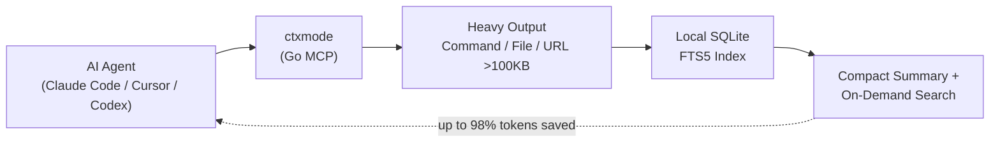

<div align="center">

<picture>
  <source media="(prefers-color-scheme: dark)" srcset="assets/logo-dark.svg">
  <source media="(prefers-color-scheme: light)" srcset="assets/logo-light.svg">
  
</picture>

# ctxmode

**Stop huge command logs and web pages from blowing up your AI's context window — a local-first Go MCP server that indexes heavy output into SQLite and saves up to 98% of tokens.**

[](go.mod)
[](README.md)
[](https://sqlite.org/fts5.html)
[](LICENSE)

[Quick Start](#quick-start) · [Highlights](#highlights) · [Tools](#tools-overview) · [Architecture](#how-it-works)

**English** · [简体中文](README.zh-CN.md)

</div>

## How it works



Your agent keeps the exit code and a short tail preview; the full output stays on disk in a local, searchable index — never in the context window.

## Highlights

| | |
|---|---|
| **Zero Node.js, single Go binary** | No NPM runtime to install or audit. Build once, point your client at one file, done. |
| **Auto-truncates, saves up to 98% tokens** | Any tool output over 100KB is written to a local SQLite index; the agent sees only `exit_code` plus a tail preview. `ctx_stats` counts exactly how many bytes stayed out. |
| **12-language execution, 50-command batch** | `ctx_run` runs Shell, Go, Python, JS/TS, Rust, PHP, Ruby, R and more; `execute_file` lets a script process a 10MB file directly, and `batch` runs up to 50 commands concurrently. |
| **Local FTS5 hybrid search + web-to-Markdown** | `ctx_kb` fuses BM25, Porter stemming, Trigram and RRF reranking; `fetch` turns web pages into indexed Markdown with built-in SSRF blocking. |
| **Repo-aware files, Git & background jobs** | `ctx_fs` resolves fuzzy paths and finds test/impl pairs; `ctx_git` is read-only; `ctx_bg` supervises background processes with streamed logs. |
| **Secret-safe by default** | Refuses to index `.env` files, private keys and credential stores, and strips sensitive environment variables from every subprocess it spawns. |

## Quick Start

### 1. Build

```bash
git clone https://github.com/dorokuma/ctxmode.git
cd ctxmode
go build -o ctxmode .
```

Requires **Go 1.26+** (see `go.mod`). No Node.js, no other runtime dependencies.

### 2. Connect to your MCP client

ctxmode speaks MCP over stdio. Add it to your client configuration — for example, in `.mcp.json` (Claude Code) or your Cursor `mcp` settings:

```json
{
  "mcpServers": {
    "ctxmode": {
      "command": "/absolute/path/to/ctxmode",
      "args": ["-workdir", "/absolute/path/to/your/project"]
    }
  }
}
```

- `-workdir` (repeatable) declares workspace roots; every `ctx_fs`/`ctx_git` path and every `cwd` is resolved against them. The first value becomes the primary workspace, which owns the index database. Without it, the current directory is used.
- `-config` points at a YAML file (`ctxmode-config.yaml`) with a `workdirs:` list — see [`config.example.yaml`](config.example.yaml).

> [!TIP]
> Each project gets its own SQLite index at `~/.local/share/ctxmode/<hash>-<basename>/`, so documents indexed in one project are never searchable from another. Run `ctx_stats` inside a session to see live context-consumption numbers — including exactly how many bytes were kept out of the context window.

## Tools Overview

Seven tools. Five take `action=` plus parameters; `ctx_stats` and `ctx_report` do not use action.

| Tool | When to use it |
|------|----------------|
| **ctx_run** | Run commands and code. `execute` for shell/argv/12 languages, `execute_file` to process a large file from a script, `batch` for up to 50 parallel commands, `run_task` for structured test/build tasks (`go_test`, `npm_run_build`, `cargo_build`, `make`, …). |
| **ctx_fs** | Workspace file operations without flooding context: `ls`, `glob`, `stat`, `rg` content search, `resolve` fuzzy path lookup, `related` test/impl pairing. |
| **ctx_git** | Read-only git: `status`, `diff`, `log`. No commit, push, or reset — ever. |
| **ctx_kb** | The local knowledge base: `index` files into SQLite FTS5, `search` them with hybrid ranking, `fetch` URLs into indexed Markdown, `stats`/`purge`/`doctor` for housekeeping. |
| **ctx_bg** | Supervise long-running jobs started with `background:true`: `list`, `kill`, `log`, `wait`. |
| **ctx_stats** | Answer "how much context did I actually save?" — per-tool call counts, bytes returned to the model, and bytes kept out in the KB. |
| **ctx_report** | Deliver a structured completion report in dispatched multi-agent sessions (bound server-side by the dispatcher; returns an error outside dispatch). |

## More Details

### Security model & credential guards

<details>
<summary>Expand: what ctxmode guards — and what it does not</summary>

ctxmode is **not a sandbox**: `ctx_run` executes commands with the server process's privileges, and `argv` mode is not path-fenced. Run it only in trusted environments. On top of that it layers defense-in-depth guards aimed at one specific threat: untrusted content (repo files, fetched pages, huge logs) leaking secrets into model context or onto disk.

- **Sensitive-file fences.** Indexing and file access refuse `.env` files, private keys (`*.pem`, `id_rsa`, …), `credentials.json`, `.npmrc`, `.netrc`, and anything under `.aws`/`.ssh`/`.gnupg`/`.kube`.
- **Subprocess environment scrubbing.** Child processes never inherit variables whose names look sensitive (`token`, `key`, `secret`, `password`, `credential`, `auth`, `cookie`, `session`, case-insensitive). `CTXMODE_ENV_PASSTHROUGH=1` disables this globally.
- **SSRF blocking.** `ctx_kb fetch` refuses loopback, link-local, private, CGNAT, reserved and embedded-IPv4 targets — the blocklist is fixed and not env-configurable.
- **Audit trail.** Every `ctx_run` call appends one JSON line to `CTXMODE_AUDIT_LOG` (default `/root/.local/state/ctxmode/audit.jsonl` — a literal path with no `~`/`$HOME` expansion, so non-root deployments must set `CTXMODE_AUDIT_LOG` explicitly): command, cwd, exit code, verdict. Process stdout/stderr are never recorded, and secret-shaped values in the command are redacted to `[redacted: … len=… sha256=…]` markers.
- **Pre-execution screen.** A command over 64KiB or containing a NUL byte is hard-blocked; hostile-looking shell idioms are logged but not blocked.

</details>

### Read-only role mode & multi-agent isolation

<details>
<summary>Expand: CTXMODE_ROLE / CTXMODE_READONLY</summary>

When a dispatcher spawns sub-agents, it sets `CTXMODE_ROLE` (`scout`, `planner`, `researcher`, `reviewer`, `oracle`, `verifier`, `worker`) or `CTXMODE_READONLY=1` in their environment. ctxmode then enforces the role contract on every `ctx_run` call:

- **All sub-agent roles** cannot launch nested agent executables, detached-session managers (`tmux`, `screen`), privilege or remote wrappers (`sudo`, `ssh`, `nsenter`, …), and cannot clear their own role marker.
- **Read-only roles** additionally lose `ctx_kb index`/`purge`/`fetch` writes (`researcher` is the exception: it keeps `ctx_kb fetch` for its tool cache, per `router.go`); the strict set also loses `ctx_bg kill`, `run_task`, write/destructive/build commands, in-place editors, git write subcommands and file-output redirects — leaving a verifiable read-only tool surface.
- Blocked calls are still written to the audit log with `screen_verdict=block`, so violations are visible instead of silent.

Ordinary single-agent use sets neither variable and is unaffected.

</details>

### Local development & testing

<details>
<summary>Expand: hooks, make check, deploy</summary>

```bash
bash scripts/install-hooks.sh   # install commit-msg + pre-push gates into .git/hooks/
make check                      # the single gate: gofmt + staticcheck + go vet + namespace-isolated go test -race + go build (+ Pi extension tests when node exists)
```

- `scripts/install-hooks.sh` installs two hard gates: `commit-msg` (Conventional Commits format, no secrets, English-only message) and `pre-push` (same checks across outgoing commits). It safely refuses when an external `core.hooksPath` is set.
- `make check` is the only supported verification entry point. `go test -race` runs through `scripts/ns-hc-gotest.sh` inside a mount/PID/net namespace; a bare `go test` is rejected by the `TestMain` outer-isolation gate (exit 125).
- `./deploy.sh` builds, verifies via an `initialize` handshake, and atomically swaps the live binary (with `<BINARY>.prev` backup and `rollback` support).

</details>

## Platform support

**Linux** is fully supported. Background-job identity verification in `ctx_bg` reads `/proc/<pid>/stat`; on other platforms ctxmode still runs but `ctx_bg kill` fails closed (a job with unknown identity is never signaled).

## Credits & License

ctxmode is a 100% Go reimplementation of Mert Koseoglu's [context-mode](https://github.com/mksglu/context-mode) — credit to the original author for the idea and the TypeScript implementation.

Licensed under the **Elastic License 2.0 (ELv2)** — see [LICENSE](LICENSE).
