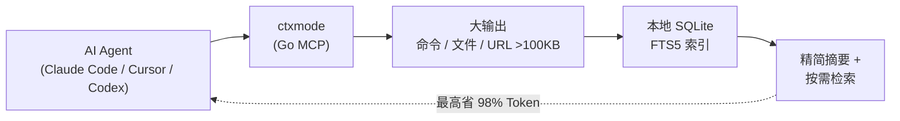

<div align="center">

<picture>
  <source media="(prefers-color-scheme: dark)" srcset="assets/logo-dark.svg">
  <source media="(prefers-color-scheme: light)" srcset="assets/logo-light.svg">
  
</picture>

# ctxmode

**别再让几万行测试日志和长网页撑爆 AI 上下文——单文件 Go MCP 服务，自动把大输出截留在本地 SQLite 索引、只回精简摘要，实测最高省 98% Token。**

[](go.mod)
[](README.zh-CN.md)
[](https://sqlite.org/fts5.html)
[](LICENSE)

[快速开始](#快速开始) · [核心特性](#核心特性) · [内置工具](#内置工具速查) · [工作原理](#工作原理)

[English](README.md) · **简体中文**

</div>

## 工作原理



Agent 只会拿到退出码和一小段尾部预览；完整输出留在本地磁盘的可检索索引里——永远不进入上下文窗口。

## 核心特性

| | |
|---|---|
| **零 Node.js，单文件 Go 二进制** | 无需安装和审计 NPM 运行时。编译一次，客户端指向一个文件即可使用。 |
| **自动截流，最高省 98% Token** | 任何超过 100KB 的工具输出自动写入本地 SQLite 索引；Agent 只看到 `exit_code` 加尾部预览。`ctx_stats` 精确统计被截留在外的字节数。 |
| **12 语言执行 + 50 命令批处理** | `ctx_run` 支持 Shell、Go、Python、JS/TS、Rust、PHP、Ruby、R 等；`execute_file` 让脚本直接处理 10MB 大文件，`batch` 最多并发跑 50 条命令。 |
| **本地 FTS5 混合检索 + 网页转 Markdown** | `ctx_kb` 融合 BM25、Porter 词干、Trigram 与 RRF 重排；`fetch` 自动把网页转成 Markdown 入库，内置 SSRF 拦截。 |
| **更懂仓库的文件、Git 与后台工具** | `ctx_fs` 支持模糊路径解析与测试/实现配对；`ctx_git` 只读；`ctx_bg` 监管后台进程并流式读取日志。 |
| **默认防泄密护栏** | 拒绝索引 `.env` 文件、私钥与凭据库；所有派生子进程自动剥离敏感环境变量。 |

## 快速开始

### 1. 构建

```bash
git clone https://github.com/dorokuma/ctxmode.git
cd ctxmode
go build -o ctxmode .
```

需要 **Go 1.26+**（见 `go.mod`）。无需 Node.js，无其它运行时依赖。

### 2. 接入 MCP 客户端

ctxmode 通过 stdio 提供 MCP 服务。把它加进客户端配置——例如 `.mcp.json`（Claude Code）或 Cursor 的 `mcp` 配置：

```json
{
  "mcpServers": {
    "ctxmode": {
      "command": "/absolute/path/to/ctxmode",
      "args": ["-workdir", "/absolute/path/to/your/project"]
    }
  }
}
```

- `-workdir`（可重复）声明工作区根目录；所有 `ctx_fs`/`ctx_git` 路径与 `cwd` 都据此解析。第一个值为主工作区，索引数据库归它所有；不指定则默认当前目录。
- `-config` 指向一份 YAML 配置（`ctxmode-config.yaml`），内含 `workdirs:` 列表——见 [`config.example.yaml`](config.example.yaml)。

> [!TIP]
> 每个项目拥有独立的 SQLite 索引，位于 `~/.local/share/ctxmode/<hash>-<basename>/`，在 A 项目索引的文档绝不会被 B 项目搜到。在会话中调用 `ctx_stats` 可实时查看上下文消耗——包括有多少字节被拦在上下文窗口之外。

## 内置工具速查

共 7 个工具。其中 5 个接收 `action=` 加参数；`ctx_stats` 与 `ctx_report` 无 `action`。

| 工具 | 什么时候用 |
|------|-----------|
| **ctx_run** | 跑命令和代码。`execute` 执行 shell/argv/12 种语言；`execute_file` 让脚本直接处理大文件；`batch` 最多并发 50 条命令；`run_task` 结构化执行测试/构建（`go_test`、`npm_run_build`、`cargo_build`、`make` 等）。 |
| **ctx_fs** | 不刷屏的工作区文件操作：`ls`、`glob`、`stat`、`rg` 内容搜索、`resolve` 模糊路径、`related` 测试/实现配对。 |
| **ctx_git** | 只读 Git：`status`、`diff`、`log`。永远不会 commit、push 或 reset。 |
| **ctx_kb** | 本地知识库：`index` 把文件索引进 SQLite FTS5，`search` 混合排序检索，`fetch` 抓网页转 Markdown 入库，`stats`/`purge`/`doctor` 做维护。 |
| **ctx_bg** | 监管 `background:true` 启动的长任务：`list`、`kill`、`log`、`wait`。 |
| **ctx_stats** | 回答「到底省了多少上下文」——各工具调用次数、回给模型的字节数、被截留在 KB 里的字节数。 |
| **ctx_report** | 在派发式多 Agent 会话中递交结构化完成报告（由派发器在服务端绑定；非派发场景会返回错误）。 |

## 进阶说明

### 安全模型与凭据护栏

<details>
<summary>展开：ctxmode 防什么、不防什么</summary>

ctxmode **不是沙箱**：`ctx_run` 以服务进程自身的权限执行命令，`argv` 模式不做路径围栏，请只在可信环境中运行。在此之上，它叠加了一组纵深防御护栏，针对的是一个具体威胁：不可信内容（仓库文件、抓取的网页、巨型日志）把密钥泄进模型上下文或落盘。

- **敏感文件围栏。** 索引与文件访问拒绝 `.env` 文件、私钥（`*.pem`、`id_rsa` 等）、`credentials.json`、`.npmrc`、`.netrc`，以及 `.aws`/`.ssh`/`.gnupg`/`.kube` 下的所有内容。
- **子进程环境净化。** 名字疑似敏感的变量（`token`、`key`、`secret`、`password`、`credential`、`auth`、`cookie`、`session`，不区分大小写）一律不传给子进程。`CTXMODE_ENV_PASSTHROUGH=1` 可全局关闭。
- **SSRF 拦截。** `ctx_kb fetch` 拒绝回环、链路本地、私网、CGNAT、保留段及内嵌 IPv4 目标——拦截名单固定，不可通过环境变量修改。
- **审计日志。** 每次 `ctx_run` 调用向 `CTXMODE_AUDIT_LOG`（默认 `/root/.local/state/ctxmode/audit.jsonl`——字面路径，源码不做 `~`/`$HOME` 展开，非 root 环境需显式设置 `CTXMODE_AUDIT_LOG`）追加一行 JSON：命令、cwd、退出码、判定结果。进程的 stdout/stderr 永不记录，命令中疑似密钥的值会被替换为 `[redacted: … len=… sha256=…]` 标记。
- **执行前筛查。** 超过 64KiB 或含 NUL 字节的命令直接硬阻断；少数可疑 shell 写法只记录不阻断。

</details>

### 只读角色模式与多 Agent 隔离

<details>
<summary>展开：CTXMODE_ROLE / CTXMODE_READONLY</summary>

当派发器拉起子 Agent 时，会在其环境中设置 `CTXMODE_ROLE`（`scout`、`planner`、`researcher`、`reviewer`、`oracle`、`verifier`、`worker`）或 `CTXMODE_READONLY=1`。ctxmode 随后在每次 `ctx_run` 调用上强制执行角色契约：

- **所有子 Agent 角色**不能启动嵌套的 Agent 可执行文件、脱离会话管理器（`tmux`、`screen`）、提权或远程封装器（`sudo`、`ssh`、`nsenter` 等），也不能清除自己的角色标记。
- **只读角色**额外失去 `ctx_kb index`/`purge`/`fetch` 写权限（例外：`researcher` 保留 `ctx_kb fetch` 作工具缓存通道，见 `router.go`）；严格只读集进一步失去 `ctx_bg kill`、`run_task`、写/删/构建类命令、就地编辑器、git 写子命令与文件输出重定向——留下一个可验证的只读工具面。
- 被拦截的调用仍会写入审计日志（`screen_verdict=block`），违规可见而非静默。

普通单 Agent 使用不设置这两个变量，完全不受影响。

</details>

### 本地开发与测试

<details>
<summary>展开：hooks、make check、deploy</summary>

```bash
bash scripts/install-hooks.sh   # 把 commit-msg + pre-push 两道门禁装进 .git/hooks/
make check                      # 唯一检查入口：gofmt + staticcheck + go vet + 命名空间隔离的 go test -race + go build（有 node 时加跑 Pi 扩展测试）
```

- `scripts/install-hooks.sh` 安装两道硬门禁：`commit-msg`（Conventional Commits 格式、禁密钥、提交信息仅英文）与 `pre-push`（对所有外发提交做同样检查）。检测到外部 `core.hooksPath` 时会安全拒绝安装。
- `make check` 是唯一受支持的验证入口。`go test -race` 经由 `scripts/ns-hc-gotest.sh` 在 mount/PID/net 命名空间内执行；裸跑 `go test` 会被 `TestMain` 外层隔离门禁拒绝（退出码 125）。
- `./deploy.sh` 编译 → `initialize` 握手验证 → 原子替换运行中二进制（带 `<BINARY>.prev` 备份与 `rollback` 支持）。

</details>

## 平台支持

**Linux** 完整支持。`ctx_bg` 的任务身份校验读取 `/proc/<pid>/stat`；其它平台上 ctxmode 仍可运行，但 `ctx_bg kill` 会失败关闭（身份不明的任务永远不会被信号）。

## 致谢与许可证

ctxmode 是 Mert Koseoglu 的 [context-mode](https://github.com/mksglu/context-mode) 的 100% Go 重实现——感谢原作者的创意与 TypeScript 实现。

基于 **Elastic License 2.0（ELv2）** 发布——见 [LICENSE](LICENSE)。
